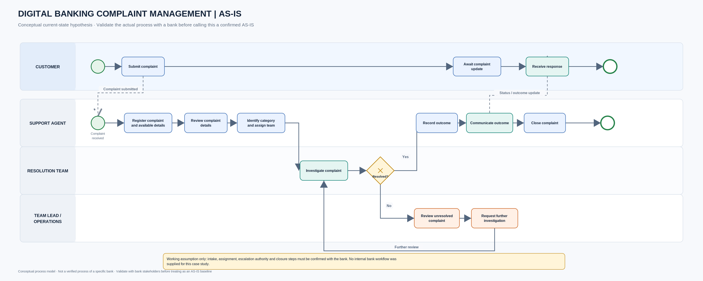
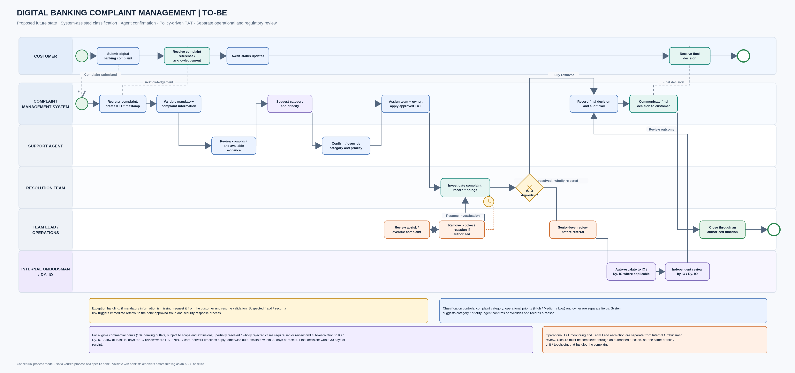

# Digital Banking Complaint Management

**Product Business Analysis case study | India-focused digital banking context**

This project proposes a structured complaint-management product to improve complaint visibility, classification, ownership, TAT monitoring, customer communication and escalation handling.

> **Project boundary and evidence note:** This is a product-analysis and process-design case study, not a live bank implementation and not a description of a named bank's production workflow. The AS-IS process is a conceptual hypothesis awaiting stakeholder validation. No private bank/customer complaint data is used. No software tests have been executed and no operational improvements are claimed.

## Project at a glance

| Area | Definition |
|---|---|
| Business question | How could a digital bank manage complaints with clearer classification, ownership, TAT visibility, communication and appropriate escalation? |
| Users / stakeholders | Customers, Support Agents, Team Leads, Operations, Bank Management, Product, Security/Fraud, Compliance, Development and QA |
| Core product capabilities | Complaint intake, categorisation, priority suggestion, human confirmation, team assignment, TAT monitoring, escalation, customer updates, review and reporting |
| Product principle | Category, operational priority and ownership are separate attributes |
| Governance principle | Avoidable operational escalation is measured separately from fraud/security referrals and mandatory regulatory review |
| Status | BA documentation and proposed workflow package; implementation and empirical KPI validation are not part of this repository |

## Documentation index

| # | Document | What it covers |
|---:|---|---|
| 01 | [Project Charter](01-project-charter.md) | Business objective, scope, success measures, assumptions, risks and deliverables |
| 02 | [Stakeholder Analysis](docs/02-stakeholder-analysis.md) | Stakeholder register, influence/interest, RACI and communication plan |
| 03 | [AS-IS and TO-BE Process Analysis](docs/03-process-analysis.md) | Current-state hypothesis, process questions, future workflow, KPIs and change summary |
| 04 | [Business Requirements Document (BRD)](docs/04-business-requirements-document.md) | Problem statement, business objectives, scope, 18 business requirements, rules, KPIs and risks |
| 05 | [Functional Requirements Document (FRD)](docs/05-functional-requirements-document.md) | 68 functional requirements, roles, data fields, workflow controls and non-functional requirements |
| 06 | [User Stories and Acceptance Criteria](docs/06-user-stories-and-acceptance-criteria.md) | 20 user stories and Given/When/Then acceptance criteria |
| 07 | [Requirements Traceability Matrix (RTM)](docs/07-requirements-traceability-matrix.md) | BRD → FRD → User Story → acceptance-criteria and test-design links |
| 07A | [RTM functional detail (CSV)](docs/07-rtm-functional-requirement-detail.csv) | Filterable FR-level traceability extract |
| 08 | [Test Scenarios and Detailed Test Cases](docs/08-test-scenarios-and-cases.md) | 32 planned functional, negative, regulatory-control and non-functional test cases |
| 09 | [Regulatory and Public References](docs/09-regulatory-and-public-references.md) | Official RBI sources and limitations on regulatory applicability |


## Public data analysis: RBI complaint trends (SQL + Power BI)

A separate analytics workstream uses official RBI aggregated complaint statistics to analyse bank complaint categories, receipt channels, regional complaint rates and ORBIO/CRPC disposal patterns. It includes CSV datasets, a preloaded SQLite database, reproducible SQL queries, findings, data reconciliation checks, DAX measures and a Power BI dashboard build guide.

- [Analytics workstream overview](analytics/README.md)
- [RBI public complaint data analysis and findings](analytics/reports/RBI-Public-Complaint-Data-Analysis.md)
- [Data dictionary](analytics/data/Data-Dictionary.md)
- [Power BI dashboard build guide](analytics/powerbi/Power-BI-Dashboard-Build-Guide.md)
- [SQL analysis queries](analytics/sql/01-analysis-queries.sql)
- [Data source register](analytics/data/source_register.csv)

**Evidence boundary:** These are aggregated external RBI Ombudsman statistics, not bank-internal case-level records. The workstream does not calculate bank resolution TAT, internal SLA attainment, agent productivity, reassignment or operational escalation rates. The quarterly FY2025-26 category snapshot is kept separate from the annual bank-only series because the source table has a broader RB-IOS scope.

## Process workflows

### AS-IS – conceptual current-state hypothesis



[Open editable AS-IS diagram](diagrams/01-as-is-workflow.drawio)

### TO-BE – proposed future state



[Open editable TO-BE diagram](diagrams/02-to-be-workflow.drawio)

The diagrams use swimlanes and BPMN-style events, activities, gateways and flows. The AS-IS must be validated with an actual bank before being treated as the confirmed current process.

## Key business design decisions

1. **Category, priority and ownership are distinct.** Category identifies the service/issue; priority indicates urgency under approved criteria; ownership identifies the accountable team or person.
2. **Human review remains part of classification.** The system may suggest a category/priority, but an authorised agent confirms or overrides it and records a reason.
3. **TAT is policy-driven.** No universal complaint deadline is assumed; the correct rule depends on the service and applicable bank, regulator or network requirements.
4. **Escalation types are separated.** Operational escalation, fraud/security referral and mandatory Internal Ombudsman review are not the same process or KPI.
5. **Targets are not fabricated.** Baselines and performance targets remain to be approved from reliable bank data.

## Regulatory context

The BRD documents relevant RBI context, including the [Commercial Banks – Internal Ombudsman Directions, 2026](https://www.rbi.org.in/scripts/NotificationUser.aspx?Id=13271) and [Reserve Bank – Integrated Ombudsman Scheme, 2026 FAQs](https://rbi.org.in/scripts/FAQDisplay.aspx?Id=153). Applicability depends on the regulated entity and complaint. The project does not present the documents as legal advice; an actual bank's Compliance/Legal function must confirm the rule catalogue, exclusions and implementation.

## Repository structure

```text
Digital-Banking-Complaint-Management/
├── README.md
├── diagrams/
│   ├── 01-as-is-workflow.drawio
│   ├── 01-as-is-workflow.png
│   ├── 02-to-be-workflow.drawio
│   └── 02-to-be-workflow.png
├── analytics/
│   ├── README.md
│   ├── data/
│   ├── sql/
│   ├── powerbi/
│   ├── reports/
│   └── rbi_complaints_analysis.sqlite
└── docs/
    ├── 01-project-charter.md
    ├── 02-stakeholder-analysis.md
    ├── 03-process-analysis.md
    ├── 04-business-requirements-document.md
    ├── 05-functional-requirements-document.md
    ├── 06-user-stories-and-acceptance-criteria.md
    ├── 07-requirements-traceability-matrix.md
    ├── 07-rtm-functional-requirement-detail.csv
    ├── 08-test-scenarios-and-cases.md
    └── 09-regulatory-and-public-references.md
```

## Completion status

| Workstream | Status | Evidence / limitation |
|---|---|---|
| Project Charter | Drafted | Business objectives and scope defined |
| Stakeholder Analysis | Drafted | Stakeholders, proposed RACI and communication plan |
| Process Analysis | Drafted | AS-IS hypothesis and TO-BE proposal; AS-IS requires validation |
| Workflow Diagrams | Created | Editable draw.io source and PNG previews |
| BRD | Draft for validation | 18 business requirements and 16 business rules |
| FRD | Draft for validation | 68 functional requirements and 10 NFRs |
| User Stories / Acceptance Criteria | Draft for validation | 20 user stories and Given/When/Then criteria |
| RTM | Draft for validation | Traceability and test-design mapping; acceptance-criteria links at story level |
| Test Design | Prepared | 32 planned test cases; all Not Run |
| Working application / integrations | Not built | Outside current portfolio scope |
| Public RBI aggregated data analysis | Prepared | CSV datasets, SQLite, SQL queries, findings and Power BI build guide; not internal bank case data |
| Actual Power BI dashboard | Build guide supplied | Build the PBIX in Power BI Desktop using the supplied CSVs and DAX; no PBIX is claimed as completed |
| Measured business outcomes | Not claimed | Requires baseline, implementation and post-change measurement |

## How to review this project

1. Start with the [Project Charter](docs/01-project-charter.md).
2. Review the [Stakeholder Analysis](docs/02-stakeholder-analysis.md) and [Process Analysis](docs/03-process-analysis.md).
3. Follow the requirements chain from BRD to FRD, User Stories and RTM.
4. Open the test plan and see how requirements are intended to be validated.
5. Inspect the editable draw.io diagrams if you want to review the process model itself.

---

**Portfolio note:** This repository demonstrates business analysis artefacts and proposed product design. It should not be described as a deployed banking system, completed software test cycle or measured operational transformation.
